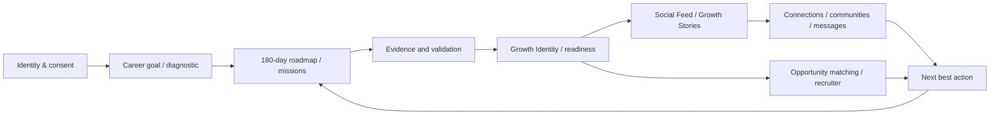
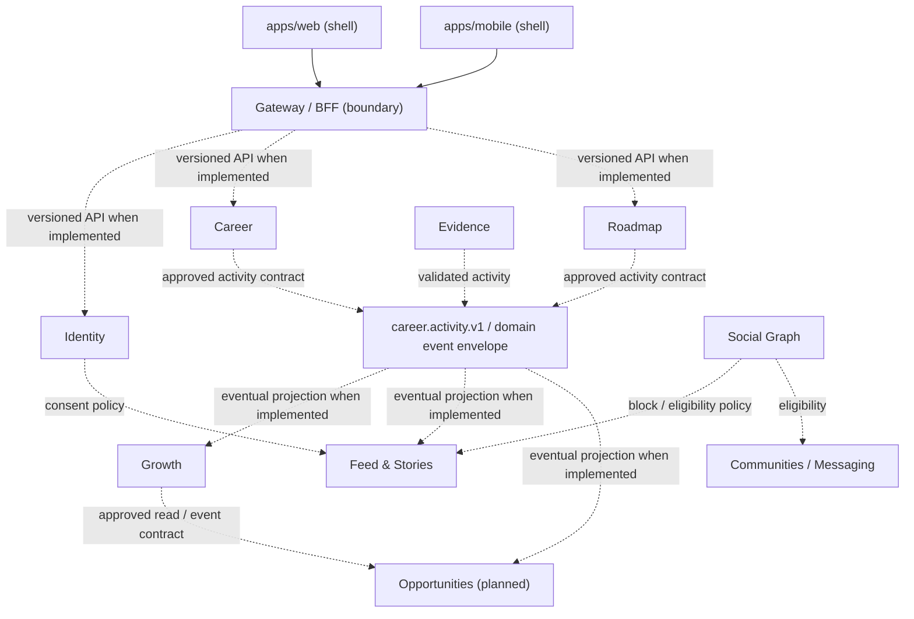
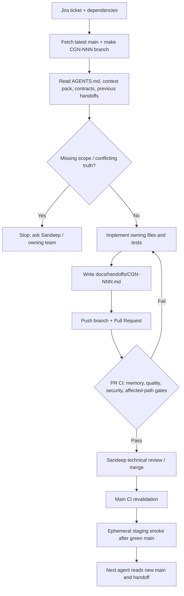

# CGN project flow — navigation map

> **Source of truth:** Jira defines planned work and dependencies; `main` + versioned contracts define implemented behavior. This drawing is a **target architecture / ownership map**, not proof that all services are running. Refresh it after architectural changes.

## Product journey (intended, Jira-scoped)

- Signed-in Home is **social-first**; My Career is **execution-first**. AI is an internal orchestration layer, not a separate source of truth.
- The arrows depict *intended business progression*, not existing HTTP endpoint or event implementations. Contracts are frozen at boundary level in `packages/contracts/architecture/bounded-contexts.v1.json`; detailed interfaces need their owning Jira tickets.
- Privacy: Identity owns consent; Social Graph owns connections/blocks; projections must not grant access denied by owning services.

## Service boundaries and integration model

**Important:** Dotted relationships are architectural policy and contract intentions, *not evidence that code or Kafka topics already exist*. Most services in `services/` remain workspace package skeletons until their owning feature tickets land. CGN-73 implements `services/gateway/` as a versioned BFF with fixed-origin routing and Identity context forwarding; downstream routes default closed and protected operations remain untrusted until CGN-101 verifies service-to-service authentication. The repository has no `services/opportunities` implementation at the time this map was authored. No service may read another service's database directly.

## Delivery and verification

**PRs are checked after a developer pushes code.** GitHub Actions does not author commits or technically prevent direct main writes on the current GitHub Free private plan. Production release/rollback is dry-run only, and 5,000 registered-beta capacity has not been proven by the health-demo smoke test.

## Evidence and updating

- [Domain ownership](../engineering-memory/02-domain-ownership.md)
- [System map](../engineering-memory/01-system-map.md)
- [Contract registry](../engineering-memory/03-contract-registry.md)
- [Module/file reference](MODULE_DEPENDENCIES.md)
- [Three-agent workflow](AGENT_WORKFLOW.md)
- [Merged state](../engineering-memory/05-current-state.md)
- [Existing CI runbook](../runbooks/ci-cd-pipeline.md)
- [Jira CGN-285](https://sandeepagrahari1.atlassian.net/browse/CGN-285)

Do not mark a ticket Done based on a diagram. Verify the actual merged SHA, tests and handoff first.
