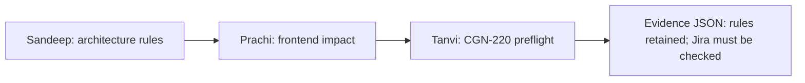

# CGN: Three team members, one engineering truth

## What this proves

This is a **deterministic offline three-role handoff test**. It runs three isolated scripts in sequence, writing redacted synthetic evidence under `.cgn/demo/three-agent/`. It does **not** run three independent AI models, complete CGN-220 or prove live Jira access. CI runs this via `tests/contracts/three-agent.contract.test.mjs`.

### Visual handoff



### Try it on a Windows VS Code terminal

Run these commands from a fresh clone of the repository:

```powershell
git checkout main
git pull origin main
corepack enable
pnpm install --frozen-lockfile
pnpm demo:three-agents
```

Expected final output:

```text
SUCCESS: Sandeep -> Prachi -> Tanvi simulated handoffs preserved project boundaries.
```

The final synthetic audit can be read at `.cgn/demo/three-agent/final-result.json`. It confirms preserved source-of-truth, ownership and security rules and clearly indicates that no product feature was implemented.

## Starting a real Jira feature

1. Read the active issue in Jira, including assignee, acceptance criteria and dependency links.
2. Pull latest `main` and create a ticket-specific feature branch. Use separate clones/worktrees for concurrent coding agents.
3. Generate a context bundle. The default is offline and includes a dated local work item if one is present:

```powershell
pnpm agent:context --ticket CGN-220 --domain admin
```

4. **Optional live Jira read-only integration**: an authorized Jira user can supply `CGN_JIRA_EMAIL` and `CGN_JIRA_API_TOKEN` as local session environment variables, then run:

```powershell
pnpm agent:context --ticket CGN-220 --domain admin --jira-live
```

   - Credentials must be stored securely outside Git, never committed to an `.env`, docs, screenshots or terminal logs.
   - The code uses HTTPS **only** to `sandeepagrahari1.atlassian.net`, uses an issue READ operation, and does not write back to Jira.
   - The connected Atlassian app used by ChatGPT does **not** automatically supply a CLI API token.
   - Without credentials the optional live mode **fails**, rather than claiming it loaded current Jira details.
   - Live Jira data is a point-in-time snapshot; issue status, blockers and scope must still be checked before changing production-sensitive behavior.
   - Generated `.cgn/context-*.md` files are Git-ignored and should not be committed. A local fallback export under `docs/work-items/` should contain only shareable, redacted requirements.

5. Read relevant source code, approved contracts, diagrams and actual merged handoffs; draft an exact-file impact plan.
6. Implement only approved scope, test, and update `docs/handoffs/CGN-NNN.md`.
7. PR CI checks the ticket-specific handoff and existing quality/security gates. Sandeep reviews, then merges into `main`. Check post-merge Main CI and staging.
8. Update Jira and `docs/engineering-memory/05-current-state.md` *only after merge evidence*, preserving the distinction between planned and implemented.

## Proof boundaries

A diagram, README, synthetic context JSON or green `health-demo` test does not prove a real Identity, Opportunities or Social feature is deployed. Future CGN-220 work must be based on actual Jira scope and existing contracts. The 5,000-user objective requires real workload testing after product services exist.
