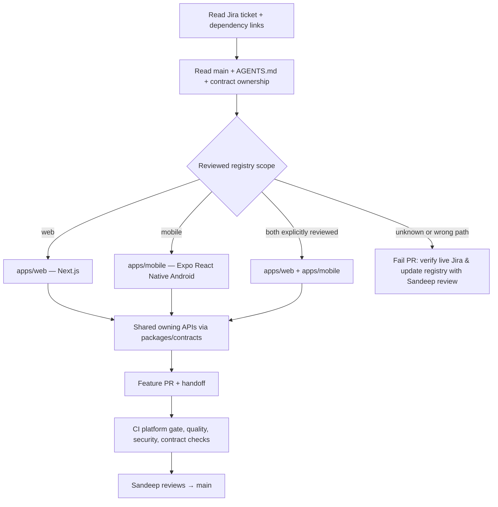

# CGN web + Android agent file ownership

**One private monorepo:** `apps/web/` is the Next.js/React web app, `apps/mobile/` is the Expo/React Native **Android** app. `services/` is shared, domain-owned backend, and `packages/contracts/` carries versioned shared APIs/schemas. There is no iOS/Apple App Store release scope. The current app folders have README/package skeletons; do not claim they are launched.

## How the coding agent knows what to edit

1. Open LIVE Jira and check ticket **summary, description, parent, assignee, component intent and links**. Do not infer platform from Jira number.
2. Inspect `config/ci/ticket-platform-scopes.v1.json`: an **offline, manually reviewed cache** of ticket platform assignments. The PR runner intentionally does not need a Jira API token.
3. Read `docs/architecture/MODULE_DEPENDENCIES.md`, `AGENTS.md`, `packages/contracts/` and relevant merged handoffs. If the ticket needs UI and backend changes, coordinate versioned contract first; do not invent another backend.
4. Web ticket example `CGN-86`: edit `apps/web/` only; touching `apps/mobile/` fails PR CI. Mobile ticket example `CGN-128`: edit `apps/mobile/` only; touching `apps/web/` fails.
5. A cross-platform Jira ticket (e.g. `CGN-133`, Sentry parity) can be registered for both **after explicit Sandeep review**. That does not automatically approve modifying other backend ownership or introducing paid SDK tiers.
6. If a new ticket is unregistered, add a reviewed platform-scope registry entry matching LIVE Jira and record the review evidence in the ticket handoff. Unknown platform edits fail closed. Anyone could technically modify the registry in their branch, so human review remains important.
7. Open a PR: `.github/workflows/pr-ci.yml` runs `node scripts/ci/verify-platform-scope.mjs` using changed files and `GITHUB_HEAD_REF`. This checks **paths**, not generated functionality. Existing required memory/quality/security checks still apply.

## Platform-specific standards

| Decision | Website | Android |
|---|---|---|
| Jira tickets | CGN-86 web shell, CGN-87 typed API | CGN-128 Expo shell, CGN-129 typed API |
| Source | `apps/web/` | `apps/mobile/` |
| UI technology | Next.js + React + TypeScript planned | Expo + React Native + TypeScript planned |
| Backend | shared owning `services/` APIs | same APIs via mobile client |
| Testing | web E2E as Jira specifies | mobile regression CGN-257 and Play readiness |
| Release | web hosting separately approved | beta CGN-251; public Play readiness CGN-287 |

**Release boundaries:** Paid Play Console registration and public submission are not authorized by the existence of a ticket. Review [Android release checklist](../runbooks/android-play-release-checklist.md) for current policy sources. **CI green ≠ Play Store approved.**

This gate cannot physically prevent direct main pushes on the current private GitHub Free repo; enforce PR-first and owner review as team rules. It does not automatically query LIVE Jira.
