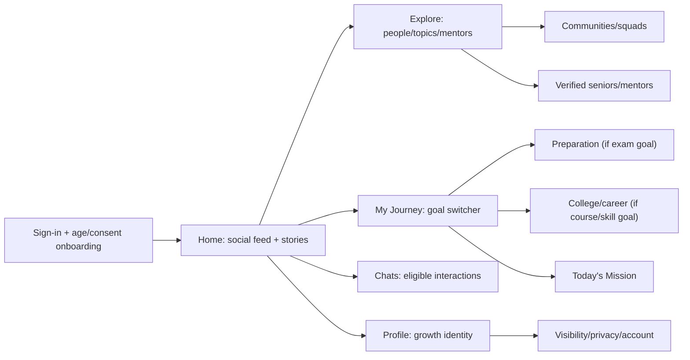

# CGN V2 — UX Architecture, Screen Inventory & Figma/Stitch Handoff

**Status:** design brief, not yet drawn/approved Figma frames. **Owner:** Prachi, [CGN-291](https://sandeepagrahari1.atlassian.net/browse/CGN-291). **Product:** [CGN V2 PRD](../product/CGN_V2_PRODUCT_VISION.md). **Final design source:** team-reviewed Figma file/frame URLs, not a generated placeholder. **Delivery:** Web Next.js `apps/web/` and Android Expo React Native `apps/mobile/`, same versioned backend contracts.

## 1. Design system rules

A coherent, welcoming social-and-growth product rather than a generic dashboard, course marketplace or LinkedIn clone. Signed-in Home is **social-first**; an execution-focused **My Journey** tab is one tap away. Goal/stage determine relevant modules but do not create dozens of inconsistent skins. Shared brand/colors/type/spacing and components across mobile+web, with platform-specific layout and navigation.

**Foundations to define in Figma:** semantic color tokens (light/dark), type scale, spacing (4/8pt), elevation/borders, contrast and large text, input sizes, focus states, icons, avatars, media ratio, localization (English/Hindi), comfortable motion and reduced-motion variants. Export token names and semantics to a versioned GitHub `DESIGN.md` only after design approval—do **not** invent token values in code ahead of approved frames.

**Reusable components:** global nav/bottom tabs, PageHeader, FeedCard, GrowthStory, ShareComposer, ProgressProofCard, PeerCard, GoalChip, JourneySwitcher, StudyTopicRow, Today'sMission, MockScoreCard, RoadmapMilestone, CommunityCard, ModeratorBadge, VerifiedExpertCard, MessageRequest, PrivateProgressToggle, SafetyNotice, FilterBar, EmptyState, LoadingSkeleton, ErrorState, OfflineBanner, ConfirmationModal and form primitives.

**Web:** breakpoint-aware sidebar/nav, centered feed + social context rail, keyboard accessible navigation, spacious execution/graph views. **Android:** native bottom tabs, touch-friendly full-width feed, mobile sheets/stack routing, push settings and device/back navigation. Avoid desktop layout simply scaled down.

## 2. Proposed top-level information architecture



Primary five Android tabs: **Home, Explore, My Journey, Chats, Profile**; secondary notifications, communities, mentoring, opportunities and settings open contextually. Bottom navigation is **proposed, not approved**.

## 3. Screen inventory with stable identifiers

These are *screen IDs*, not proof of existing frames or Jira implementation tickets. All screens require accessibility, loading, empty, error, offline (where meaningful), permission-denied, blocked and sensitive-privacy state definitions.

| Family | Screen IDs and layout intent | Primary status | Relevant existing Jira |
| --- | --- | --- | --- |
| Auth | AUTH-01 Welcome; 02 Signup; 03 Login; 04 Recover; 05 Verify; 06 Privacy/age consent | P0 | CGN-11 |
| Personalization onboarding | ONB-01 Stage; 02 Select goals; 03 Exam selection; 04 Attempt/date; 05 Education details; 06 Interests; 07 Peer consent; 08 Finish | P0 | CGN-289/291, CGN-13/14 |
| Social Home | SOC-01 For You/Following feed; 02 Story rail/viewer; 03 Post detail; 04 Compose; 05 Share milestone; 06 Saved posts; 07 Notifications | P0/P1 | CGN-28/262, CGN-267/268 |
| Explore | EXP-01 Universal search; 02 Result filters; 03 Peers; 04 Communities; 05 Mentors; 06 Opportunities | P0/P1 | CGN-21/23/24 |
| My Journey | JRN-01 Journey overview; 02 Goal switch; 03 Add/pause/archive; 04 Timeline; 05 Milestones; 06 Next best action; 07 Transition | P0/P1 | CGN-13–17 + CGN-290 |
| Preparation | PREP-01 Exam dashboard; 02 Subject chapters; 03 Topic detail; 04 Timetable; 05 Today; 06 Mock log; 07 Revision planner; 08 Topic analytics; 09 Resources | P0/P1/P2 | CGN-289/290; Roadmap/Evidence existing |
| College/career | CAR-01 College overview; 02 Skill roadmap; 03 Project evidence; 04 Internship prep; 05 Portfolio; 06 Career readiness; 07 Opportunities | P0/P1 | CGN-14–19/24 |
| Progress | GRW-01 Private growth graph; 02 Activity log; 03 Evidence; 04 Achievements; 05 Sharing/privacy; 06 Weekly report | P0/P1 | CGN-15/18/26 |
| Peer network | PEER-01 Suggestions; 02 Peer preview; 03 Connections; 04 Requests; 05 Compare goals (opt-in, no global rank); 06 Block/report | P0/P1 | CGN-21/172/175 |
| Communities | COM-01 Discovery; 02 Home/feed; 03 Discussion; 04 Join/leave; 05 Members; 06 Moderator/report | P0/P1 | CGN-22/263/272 |
| Messaging | MSG-01 Inbox; 02 Eligible DM; 03 Requests; 04 Group discussion; 05 Restriction/error; 06 Settings | P0/P1 | CGN-264 |
| Mentors | MTR-01 Discover; 02 Verified profile; 03 Public Q&A; 04 Request; 05 Session/feedback; 06 Verification | P0 limited/P1/P2 | CGN-23 |
| Opportunities | OPP-01 Feed; 02 Search/filter; 03 Detail; 04 Saved; 05 Application tracker | P1 | CGN-24/25 |
| AI assistant | AI-01 Suggested plan review; 02 Explain/update; 03 Weekly recommendation; 04 Failed/needs validation | P0/P1 | CGN-20 |
| Preferences/support | SET-01 Account; 02 Privacy/consent; 03 Blocked; 04 Notifications; 05 Data deletion; 06 Help/report | P0 | CGN-10/11/27 |
| Admin/moderation | ADM-01 Queue; 02 Incident; 03 Mentor verify; 04 Goal catalog; 05 Audit; 06 Support | P0/P1 | CGN-27/278 |

This inventory totals **approximately 100 conceptual route/screens or screens/states**, *not* 100 unique bespoke layouts to code. Shared templates and screen variants reduce design/engineering effort.

## 4. First approved-for-design batch (NOT yet approved Figma artifacts)

1. **ONB-01/02/03/05/07:** students choose life stage, primary/secondary goals and privacy; NEET + B.Tech examples; don't force a course or peer invitation.
2. **SOC-01/02/05:** Feed with optional study-progress cards, stories and "take action" CTA; users control marks/study hours visibility.
3. **JRN-01/02/07:** both journeys represented as goal cards; switching retains history and social connections, with explicit confirmation rather than hidden auto-transition.
4. **PREP-01/02/04/05:** NEET personal dashboard, subject breakdown and editable weekly plan; test score provenance and no promised rank/admission.
5. **PEER-01/04 and MTR-02:** stage-aware suggestions, accepted connections, verification badges, minor-safe restricted contact.

**Required variants** for every first-batch screen: desktop web 1440px, tablet layout where meaningful, Android mobile ~390px reference plus smaller device checks; light mode initially; accessibility/reduced motion; English/Hindi wrapping; authenticated/unauthenticated; loading/empty/failure; privacy and restricted account states; offline/poor connection UX.

## 5. Journey examples for interactive prototype

**NEET:** join as Class 11 → select NEET and attempt → see private plan → consent to peer suggestions → choose one peer group → log a topic completion → choose whether to share public-safe progress → advance to new stage **only with user action**. Never assume the student passed NEET or got MBBS admission.

**B.Tech:** join as year 1 Computer Engineering → choose coding/project goal → see career roadmap → join peers/seniors → log completed mini-project with evidence → share with audience → discover internship preparation later.

**Safety negative flows:** restricted under-18 account → unverified adult mentor DM request rejected; blocked user unable to view private progress; deleted post not visible in feed projection; AI schedule unavailable → editable manual plan fallback; fake expert badge refused.

## 6. Google Stitch / AI design master brief (copy into a design tool)

> Design an industry-grade, modern, welcoming cross-platform student social growth ecosystem called **CGN — Your Journey. Your People. Your Growth.** It is **not just exam coaching or a career dashboard**. One user has an identity, multiple evolving education/exam/career goals, optional community/peer network, proof-based growth, verified seniors/mentors and social feed. Create a cohesive design system and high-fidelity desktop Next.js and Android Expo/React Native UIs using reusable semantic components; professional typography, whitespace, accessible contrast and consistent avatars/cards. Home must be **social-first** (authentic opted-in student progress posts, growth stories, relevant communities, peer activity and helpful calls to action). My Journey must be **execution-first** (goal switcher, daily goals, milestones and user-controlled study/career plans). Show **two complete user journeys**: (A) Class 11 NEET aspirant with exam-target year, Physics/Chemistry/Biology, revision, editable timetable, private mock logs and moderated NEET cohort; (B) B.Tech First Year student with career skills, coding projects, portfolio, internship preparation and seniors. Show onboarding with stage/goal/interest selection, consent, age-appropriate defaults and no forced peer connects; peer discovery, accept request, community Q&A, verified mentor public profile, messaging request eligibility; progress share composer and privacy controls. Create desktop layout with sidebar/feed/context panel and Android bottom navigation Home / Explore / My Journey / Chats / Profile. Supply loading, empty, error, offline, disabled, minor-restricted and privacy settings variants. Use realistic Indian-student example copy without private personal data, fake certifications, guaranteed exam rank or manipulative FOMO. Include component variants and click-through navigation maps. Label screens using ONB-*, SOC-*, JRN-*, PREP-*, PEER-* IDs and keep styles reusable. Output draft design/screens for human Figma review; do not imply actual code or APIs exist.

**Do not upload secrets, user analytics, minor profiles or private Jira screenshots into generative design tools.** Use generated sample data.

## 7. Approved design handoff contract (filled only after live Figma review)

Every Jira design/implementation ticket must include:

```yaml
screen_id: "PREP-01"
figma_file_url: "PENDING_REVIEWED_FIGMA_URL"
figma_frame_url: "PENDING_REVIEWED_FRAME"
figma_version_or_review_date: "PENDING"
design_owner: "Prachi"
product_approval: "PENDING"
platform: "web | android"
allowed_ticket: "PENDING_SPLICED_IMPLEMENTATION_TICKET"
approved_api_contract_ref: "PENDING_CGN-290"
component_variants: ["default", "loading", "empty", "error", "restricted", "offline"]
accessibility: "keyboard/focus for web; touch/screen reader for Android"
privacy_rules: "Consent- and age-aware visibility, no global marks ranking"
test_evidence: "PENDING"
```

Do NOT paste these literal `PENDING` placeholders into existing coding tickets as if designs were approved. Live Figma links must be actual file/frame refs checked by Prachi. New *web vs Android* implementation tickets need separately reviewed entries in `config/ci/ticket-platform-scopes.v1.json` (CGN-286 guardrail), plus standard contract/handoff CI.

## 8. Design approval checklist

- [ ] Compare existing approved Figma screens and preserve compatible assets (file ID currently not established in this task).
- [ ] Confirm student onboarding, exam, college, mentor and underage privacy flows with relevant owners.
- [ ] Define shared components and naming/token exports before creating 100+ duplicated frames.
- [ ] Complete Web and Android variants for first P0 batch; validate responsive, interaction and accessibility behavior.
- [ ] Obtain explicit reviewed frame URLs and design version; comment on source Jira tickets.
- [ ] Review with Sandeep, Prachi and Tanvi; close consent/moderation questions before implementation.
- [ ] Only then publish `DESIGN.md` + verified Figma refs to GitHub and add narrow Jira implementation tickets with platform ownership, API contract, acceptance tests and screenshot parity test plan.

**No Figma design frames were created or modified as part of CGN-288; this is a traceable design brief.**
