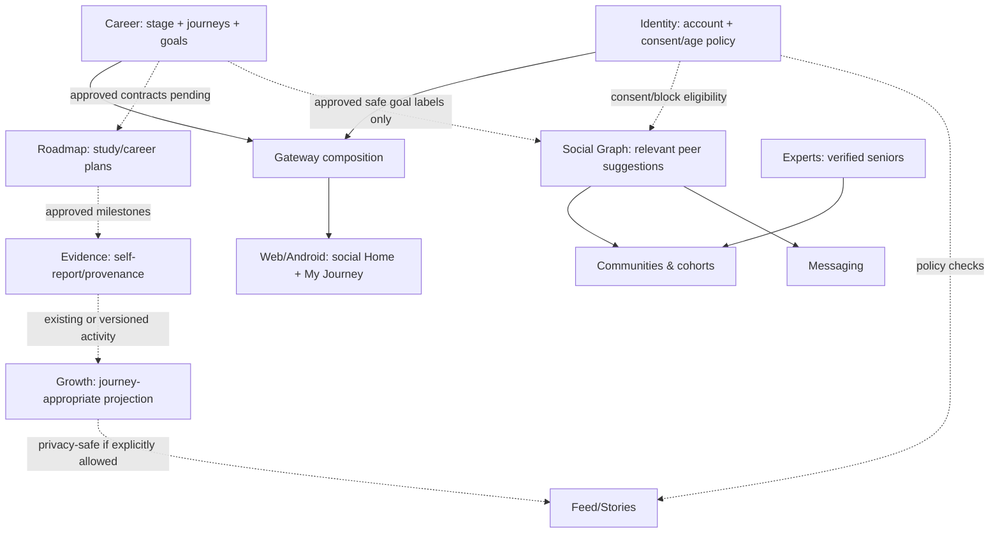

# CGN V2 — Architecture / Contract Impact Review

**State:** impact analysis, NOT a new deployed architecture or machine-readable contract. **Technical design authority:** Sandeep, [CGN-290](https://sandeepagrahari1.atlassian.net/browse/CGN-290). **Baseline sources:** [bounded contexts](../../packages/contracts/architecture/bounded-contexts.v1.json), [domain ownership](../engineering-memory/02-domain-ownership.md), [system map](../engineering-memory/01-system-map.md) and [contracts registry](../engineering-memory/03-contract-registry.md). Any divergent solution must receive a separate ADR before implementation.

## 1. What we preserve

- One private monorepo, website `apps/web/` (Next.js) and Android `apps/mobile/` (Expo React Native), shared owning service APIs and versioned contracts.
- Source truth stays: Jira = work/dependencies; merged GitHub main = implementation; bounded-context contract = data/API ownership; approved Figma = interaction/UI intent.
- **Home social-first** and **My Career execution-first**. V2 may rename the user-facing execution workspace **My Journey**; do not silently rename existing API domains.
- `identity` owns account, roles and consent; `career` goals/tracks/diagnostics; `roadmap` plans/milestones/missions; `evidence` proof/provenance; `growth` longitudinal skill/readiness; `social-graph` connections/block; `feed` public-safe projections; `communities` membership/moderation; `messaging` conversations; `experts` expertise workflow. Gateway/BFF composes but does not own domain truth.
- Existing `career.activity.v1` **only describes approved eligible career activity**. Adding exam-study events requires contract design, producer/consumer tests and likely explicit version evolution; no unaudited generic "study.activity" topic/event.

## 2. Candidate concepts — NOT final schema

| Concept | Candidate owner | Must not leak into | Review / decision required |
| --- | --- | --- | --- |
| Account age range/permissions/guardian consent | Identity | public profile / admin raw logs | Privacy review: minimal fields, age gating and regional legal applicability |
| Educational stage (Class 11/12, undergrad, grad, etc.) | Career contextual state | core Identity auth record unless policy needed | Single canonical owner & change history |
| Journey and goal state, active/paused/completed/archived | Career | UI-specific duplicated tables | Multi-goal constraints, stage transitions, history and concurrency |
| Exam/catalog metadata, attempt/year and version | Career catalog or approved independent catalog | raw AI output | Versioning, official sources, content licensing |
| Preparation topic milestones and task schedule | Roadmap | duplicate preparation microservice | Plan durations, reschedule, subject/time-zone boundaries |
| Self-reported mock result and preparation evidence | Evidence | verified expert score or Growth rank without provenance | Self-report semantics, revision/correction, privacy |
| Stage-appropriate growth projection | Growth | global comparability rank | Metrics per journey type; rollback of bad projections |
| Relevant goal/stage peer suggestions | Social Graph matching layer consuming Career policy-filtered projections | raw private grades, birthdate, direct Career DB | Eligibility/filter contracts and opt-in |
| Study-circle membership | Communities / Cohorts | Social Graph block truth | under-18 eligibility, reporting/moderation |
| Feed of voluntarily shared achievements | Feed | private task/score truth | event projection rules, consent and deletion |
| Mentor identity/qualification and safe request workflows | Experts consuming Identity verification | self-asserted expert badge | verification evidence, direct contact restrictions |
| Analytics of meaningful growth | Analytics | identifiable raw minor study behavior | consent, aggregation, event retention |
| AI plan/recommendation | AI orchestration only | canonical goal or exam official truth | human edits, source validation and fallbacks |

**No new database, service, endpoint or event schema is approved by this table.**

## 3. Proposed domain interaction — conceptual only

Dashed arrows represent future contract design **not runtime facts**. Social Graph remains owner of block/connection truth; Feed, Messages, Notifications and Admin must enforce source privacy changes.

## 4. API and contract review checklist (CGN-290)

1. Verify current original schemas and event producer/consumer lists in `packages/contracts/`; add new fields **additively** wherever compatible; version breaking changes and migration path.
2. Define typed journey identifier, goal class and stage metadata; separate subject/catalog reference from user task state. Document canonical owner and uniqueness/transition invariants.
3. Define source of truth for user-provided vs official data: mock score, teacher/mentor verification, completion/evidence confidence.
4. Define status transition behavior (pause/change/restart goal); migration of legacy college-only records without losing historical progress.
5. Define cross-domain visibility contract for social sharing, block, deletion and private-by-default study activity; exercise negative authorization tests on **web and mobile**.
6. Ensure age/consent status is enforced **server-side** and propagates to messaging/mentor requests, privacy-safe matching, notifications and moderation. Required legal review before minor rollout.
7. No direct cross-service database access. Any new API endpoint or event has owning ticket, versioned contract, and tests (integration, contract, privacy, idempotency, replay).
8. Eventual consistency/rollback: duplicate activity events, changed/deleted privacy settings, paused goals and stale user stage must not leave unauthorized feed artifacts.
9. AI plan generation must be optional, fall back to deterministic/editable templates when offline or rate limited, and not write directly into canonical facts without user consent.
10. Report existing old-schema/API consumers and migration risks before proposing a design freeze.

## 5. Proposed ADR decisions (each requires explicit owner review)

| Decision | Options | Recommendation to evaluate, not approval |
| --- | --- | --- |
| Journey ownership | extend Career / new service | Prefer extend Career unless scale/contracts justify a new bounded context |
| Exam catalog authority | versioned Career catalog / independent verified content service | Start with curated versioned small pilot and proven official/licensed sources |
| Test scores | self-report in Evidence / academic specialized domain | Keep provenance distinction, allow correction; no fake "official" marks |
| Stage and minors consent | Identity owns all / split Account-policy and Career journey | Keep Consent in Identity; career-stage truth in Career only after ADR |
| Feed/stories | one shared feed / separate exam feed | Prefer single feed with relevance and visibility filters; Home social-first |
| Web/Android design | share business contracts / duplicate implementations | Shared contracts, **platform-specific** presentation and QA |

## 6. Pilot and safe rollout

**Proposed pilot:** NEET journey plus B.Tech 1st-year journey, subject to CGN-292 interviews. One standardized onboarding and one shared Home but different My Journey/task/goal templates. A NEET→MBBS transition is an important design prototype and migration test, not a guaranteed automatically inferred enrollment outcome.

A staged implementation sequence, only after approval: (A) identity/stage + privacy policy; (B) goal/journey schema and migration; (C) plan/tasks/evidence; (D) privacy-safe feed, peer matching, community; (E) mentor role verification and optional messaging; (F) web+Android parity, monitoring and beta. Have contract/migration/rollback and deletion tests per slice.

**Exit criteria for CGN-290:** approved ADR(s), source-of-truth entity model, compatibility matrix, API/event contract proposals with identifiers and owners, permissions/risk tests, eventual consistency plan, cost/security review and explicit implementation ticket breakup. Until then, **no code/schema/data migration changes**.
